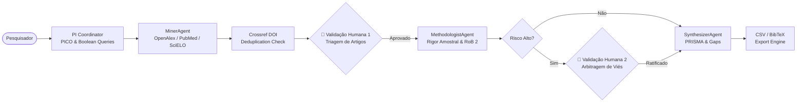

# 🔬 CortexLab / SciLab Agents
### Human Augmentation in Scientific Research & Systematic Reviews
> **Uma plataforma multi-agente de rigor acadêmico e nível comercial para amplificação cognitiva do pesquisador científico.**

[](LICENSE)
[](https://www.python.org/)
[](https://nextjs.org/)
[](https://github.com/langchain-ai/langgraph)
[](#-arquitetura-100-zero-cost)
[](http://www.prisma-statement.org/)
[](#-roadmap-de-12-semanas-residência-em-ia)

---

## 🌟 O que é o CortexLab?

O **CortexLab** é uma plataforma de **Human Augmentation** projetada para transformar a maneira como pesquisadores, pós-graduandos e laboratórios conduzem **Revisões Sistemáticas de Literatura** e **Auditorias Metodológicas**.

Diferente de chatbots genéricos que resumem textos superficialmente e inventam citações, o CortexLab combina:
1. **Motor Multi-Agente Científico (Python, FastAPI, LangGraph):** Minera APIs públicas abertas (OpenAlex, Europe PMC, PubMed/NCBI, SciELO, arXiv), valida DOIs na Crossref com requisição HTTP obrigatória, disseca seções de métodos/resultados e audita rigor estatístico (amostra $N$, $p$-valores honestamente reportados e risco de viés Cochrane RoB 2).
2. **Interface em Fluxo Guiado de 4 Etapas "Clean Academic Daylight" (Next.js 14, Tailwind CSS, HTML5 Canvas 2D HD-2D):** Inspirada na sobriedade de **Linear, Notion e Elicit**, conduz o pesquisador em uma jornada linear e sem sobrecarga cognitiva: Etapa 1 (Pergunta & Protocolo PICO) ➔ Etapa 2 (Laboratório Pixel Art HD-2D Vivo) ➔ Etapa 3 (Triagem Humana Soberana HITL) ➔ Etapa 4 (Caderno PRISMA 2020, Cochrane RoB 2 e Lacunas Científicas).
3. **Laboratório Isométrico Pixel Art HD-2D Vivo (`IsometricLabCanvas.tsx`):** Renderizado em HTML5 Canvas 2D a 60 FPS com zero dependências de bibliotecas 3D pesadas (sem Three.js/WebGL), apresentando 7 cientistas com funções reais conectadas ao código do backend em 5 salas interconectadas (Coordenação PICO, Mineração/Crossref, Supervisão HITL, Auditoria RoB 2 e Biblioteca PRISMA), com animações de handoff físico de documentos pelas portas e corredores.
4. **Supervisão Humana Soberana (Human-in-the-Loop):** Portões de validação no grafo onde os assistentes de IA pausam a execução e aguardam o crivo do pesquisador em etapas críticas de triagem de elegibilidade e arbitragem de risco de viés.
5. **Arquitetura 100% Gratuita (Zero-Cost):** Projetada para rodar integralmente nas cotas gratuitas do Google Gemini, Groq Cloud, Supabase, Hugging Face Spaces e Vercel, com suporte a BYOK (*Bring Your Own Key*) direto no navegador e sessão demonstrativa pré-semeada out-of-the-box.

---

## ⚖️ Por que Human Augmentation e não "IA Autônoma"?

| Critério Científico | Processo Manual Tradicional | Chatbots Genéricos (ChatGPT / Claude) | **CortexLab (Human Augmentation)** |
| :--- | :--- | :--- | :--- |
| **Tempo de Triagem** | Semanas ou meses de leitura | Minutos (mas não confiável) | **Redução de ~65% com rigor metodológico mantido** |
| **Alucinação de DOIs** | 0% (leitura direta) | **Alta (inventa artigos e fontes)** | **0.00% (Validação Crossref mandatória)** |
| **Rastreabilidade** | Notas em planilhas / papel | Afirmações soltas sem parágrafo | **Link direto com citação literal (*verbatim*)** |
| **Auditoria Metodológica** | Exaustiva (cálculo de poder, RoB 2) | Ignorada ou superficial | **Agente Auditor com checklists formais** |
| **Governança Humana** | 100% manual | Nenhuma (caixa preta) | **LangGraph HITL Checkpoints programáticos** |
| **Padrão de Saída** | Preenchimento manual no Excel | Texto solto não estruturado | **Matriz PRISMA 2020 + BibTeX exportável para Zotero** |

---

## 🏛️ Arquitetura Multi-Agente (LangGraph Engine)

O fluxo de raciocínio é orquestrado por um grafo cíclico de estados com nós modulares e persistência de checkpoints:



### 🏢 Salas e Cientistas no Laboratório Virtual HD-2D
- 🧭 **Sala 01: Coordenação PI (`pi_coordinator_node`):** Dr. Turing decompõe a pergunta de pesquisa no protocolo PICO 2x2 no quadro digital e elabora estratégias de busca booleana com descritores controlados (MeSH/DeCS). Ao concluir, caminha até a Sala 02 para entregar o protocolo à Dra. Ada.
- 🔍 **Sala 02: Mineração & Validação (`miner_node`):** Dra. Ada minera artigos científicos nas APIs abertas (OpenAlex, Europe PMC, PubMed) enquanto Dr. Cross valida os DOIs contra o servidor oficial da Crossref e elimina duplicatas. O pacote validado é levado até a Sala 03 Central.
- 🛑 **Sala 03 Central: Supervisão Humana Soberana (HITL - `human_screening_node` / `human_bias_node`):** O avatar do pesquisador humano decide quais artigos entram na revisão sistemática e arbitra estudos com alto risco de viés, entregando a pasta aprovada para a Sala 04.
- 📊 **Sala 04: Auditoria Metodológica & Estatística (`methodologist_node`):** Dr. Fitz extrai tamanho amostral $N$, grupo controle e $p$-valores na bancada frontal e entrega para a Dra. Cochrane na bancada superior, que classifica o estudo segundo o Cochrane RoB 2 / STROBE e leva os laudos à Biblioteca.
- 📑 **Sala 05: Biblioteca & Síntese PRISMA (`synthesizer_node`):** Dra. Rosalind cruza referências nas estantes, consolida a Matriz PRISMA 2020 (com Qualis CAPES e Quartil SJR), mapeia as Lacunas de Conhecimento (*Knowledge Gaps*) e gera as fichas comparativas e arquivos `.CSV` e `.BibTeX`.

---

## 🎨 Identidade Visual & UX: Design System "Clean Academic Daylight"

Inspirado nas melhores práticas editoriais acadêmicas (**Linear, Notion e Elicit.com**):
- **Superfície Clara e Iluminada:** Fundo editorial em `#FAF9F6`, cartões em branco puro com bordas suaves (`border-slate-200`) e tipografia editorial (**Newsreader** para títulos serifados e **Plus Jakarta Sans** para corpo de texto).
- **Fluxo Guiado de 4 Etapas (Zero Poluição Visual):** Exibe com clareza estrita apenas 1 etapa por vez:
  - **Etapa 1:** Pergunta de Pesquisa, Quadro PICO 2x2 e Query Booleana com suporte a exemplos reais e modo demonstrativo pré-carregado.
  - **Etapa 2:** Laboratório Científico Pixel Art HD-2D vivo em tela cheia com telemetria e cards didáticos de cada sala.
  - **Etapa 3:** Triagem Humana Soberana (HITL) com cards grandes e selecionáveis diretamente na tela.
  - **Etapa 4:** Caderno de Síntese PRISMA 2020 com alternância entre Fichas Detalhadas e Tabela Comparativa, citação literal rastreada (*verbatim*), Knowledge Gaps e barra de exportação para Excel (.CSV) e BibTeX (.bib).

---

## 💰 Arquitetura 100% Zero-Cost

O projeto foi intencionalmente arquitetado para permitir que qualquer pesquisador, laboratório universitário ou bolsista opere sem custos de infraestrutura:

| Componente | Provedor Gratuito | Cota / Benefício | Suporte a BYOK |
| :--- | :--- | :--- | :--- |
| **LLM Primário** | **Google Gemini Free Tier** | 15 RPM / 1M TPM (`gemini-1.5-flash`) | Sim (chave no browser) |
| **LLM Secundário** | **Groq Cloud Free Tier** | 30 RPM (`llama-3.3-70b-versatile`) | Sim |
| **Backend API** | **Hugging Face Spaces** | Docker Container gratuito (Porta 7860) | Deploy contínuo |
| **Frontend Web** | **Vercel Free Tier** | Hospedagem global Edge Next.js | Sim |
| **Banco de Dados** | **Supabase Free Tier** | PostgreSQL + `pgvector` (500MB gratuitos) | Sim |
| **APIs Científicas** | **OpenAlex, PubMed, SciELO, arXiv** | 100% públicas, abertas e gratuitas | N/A |

---

## 🚀 Como Executar Localmente (Passo a Passo)

> 💡 **Dica Importante:** Para rodar a aplicação completa, abra **dois terminais separados**, ambos a partir da pasta raiz `cortex-lab/`.

### Pré-requisitos
- **Node.js** >= 18.0 ([Download](https://nodejs.org/))
- **Python** >= 3.11 ([Download](https://www.python.org/))
- Git

---

### Terminal 1: Servidor Backend (FastAPI + LangGraph)

Partindo da pasta raiz do projeto (`cortex-lab`):

#### No Windows (PowerShell):
```powershell
# 1. Entrar na pasta do backend
cd backend

# 2. Copiar o arquivo de ambiente (se ainda não existir)
Copy-Item .env.example .env

# 3. Criar e ativar o ambiente virtual Python
python -m venv .venv
.\.venv\Scripts\Activate.ps1

# 4. Instalar as dependências
pip install -r requirements.txt

# 5. Iniciar o servidor FastAPI (Porta 7860 padrão HF Spaces)
uvicorn app.main:app --reload --host 0.0.0.0 --port 7860
```

#### No Linux / macOS (Bash):
```bash
# 1. Entrar na pasta do backend
cd backend

# 2. Copiar o arquivo de ambiente
cp .env.example .env

# 3. Criar e ativar o ambiente virtual Python
python3 -m venv .venv
source .venv/bin/activate

# 4. Instalar as dependências
pip install -r requirements.txt

# 5. Iniciar o servidor FastAPI
uvicorn app.main:app --reload --host 0.0.0.0 --port 7860
```

> ✅ O backend estará rodando em `http://localhost:7860` com documentação interativa OpenAPI em `http://localhost:7860/docs`.

---

### Terminal 2: Interface Frontend (Next.js 14)

Abra um **segundo terminal** também a partir da pasta raiz do projeto (`cortex-lab`):

#### No Windows (PowerShell):
```powershell
# 1. Entrar na pasta do frontend
cd frontend

# 2. Copiar as variáveis de ambiente (se ainda não existir)
Copy-Item .env.example .env.local

# 3. Instalar as dependências Node.js
npm install

# 4. Iniciar o servidor de desenvolvimento
npm run dev
```

#### No Linux / macOS (Bash):
```bash
# 1. Entrar na pasta do frontend
cd frontend

# 2. Copiar as variáveis de ambiente
cp .env.example .env.local

# 3. Instalar as dependências Node.js
npm install

# 4. Iniciar o servidor de desenvolvimento
npm run dev
```

> ✅ A interface visual estará acessível no navegador em `http://localhost:3000`.

---

### 🧪 Executando os Testes Automatizados

Para validar o motor de extração, nós modulares e regras de negócio:

```powershell
# A partir da pasta backend/ com a venv ativada:
python -m pytest -v tests/
```

Para validar a integridade de tipos TypeScript e compilação de produção:

```powershell
# A partir da pasta frontend/:
npm run build
```

---

## 📂 Estrutura do Monorepo

```
cortex-lab/
├── .github/
│   └── workflows/
│       ├── ci.yml                     # Pipeline CI (Lint, Pytest, Next.js Build)
│       └── deploy-hf-space.yml        # Deploy automático no Hugging Face Spaces
├── docs/
│   ├── 01-discovery/
│   │   └── desk-research-benchmark.md # Fundamentação científica (PRISMA 2020, RoB 2 & Benchmark de IA)
│   ├── 02-requirements/
│   │   └── functional-reqs.md         # Requisitos Funcionais e Não-Funcionais (SRS)
│   ├── 03-architecture/
│   │   └── c4-diagrams.md             # Diagramas C4 e Máquina de Estados LangGraph
│   └── 04-validation/
│       └── empirical-metrics.md       # Métricas empíricas e protocolo de validação
├── backend/
│   ├── app/
│   │   ├── agents/
│   │   │   ├── state.py               # LabGraphState tipado com telemetria e HITL
│   │   │   ├── graph.py               # Grafo LangGraph compilado com roteamento
│   │   │   └── nodes/                 # Nós modulares dos agentes
│   │   │       ├── pi_coordinator.py  # PI: PICO e queries booleanas
│   │   │       ├── miner_node.py      # Minerador: OpenAlex, PubMed e SciELO
│   │   │       ├── methodologist_node.py # Auditor: Tamanho N, p-valores e RoB 2
│   │   │       └── synthesizer_node.py   # Sintetizador: PRISMA e Knowledge Gaps
│   │   ├── prompts/                   # Prompts do sistema isolados em Markdown (.md)
│   │   ├── db/
│   │   │   ├── supabase.py            # Persistência PostgreSQL com fallback em memória
│   │   │   └── migrations/            # Schema SQL com extensão pgvector
│   │   ├── services/
│   │   │   ├── exporter.py            # Exportação de Matriz CSV e BibTeX (.bib)
│   │   │   ├── open_apis.py           # Clientes HTTP assíncronos das bases abertas
│   │   │   └── pdf_parser.py          # Segmentação canônica de PDFs
│   │   ├── api/v1/
│   │   │   └── router.py              # Endpoints REST e streaming SSE
│   │   ├── core/
│   │   │   ├── config.py              # Configurações Pydantic Settings
│   │   │   └── llm_provider.py        # Provedores Gemini e Groq com tolerância a falhas
│   │   └── main.py                    # Entrypoint da aplicação FastAPI
│   ├── tests/
│   │   └── test_api.py                # Bateria completa de testes automatizados
│   ├── Dockerfile                     # Imagem de contêiner para Hugging Face Spaces
│   └── requirements.txt
├── frontend/
│   ├── src/
│   │   ├── app/
│   │   │   ├── globals.css            # Tema Editorial Daylight (#FAF9F6) e fontes
│   │   │   ├── layout.tsx             # Metadados e estrutura raiz
│   │   │   └── page.tsx               # Fluxo Guiado de 4 Etapas + Caderno Editorial
│   │   ├── store/
│   │   │   └── useLabStore.ts         # Estado reativo Zustand com suporte a BYOK
│   │   ├── hooks/
│   │   │   └── useAgentStream.ts      # Consumo em tempo real de eventos SSE
│   │   ├── components/
│   │   │   ├── spatial/
│   │   │   │   └── IsometricLabCanvas.tsx  # Laboratório Isométrico Pixel Art HD-2D (HTML5 Canvas 2D, 60 FPS)
│   │   │   ├── dashboard/
│   │   │   │   ├── PrismaMatrixTable.tsx   # Tabela comparativa limpa estilo Elicit/Notion
│   │   │   │   ├── KnowledgeGapsCard.tsx   # Cards editoriais de lacunas científicas
│   │   │   │   └── ExportToolbar.tsx       # Exportação para CSV e BibTeX
│   │   │   └── settings/
│   │   │       └── ByokConfigModal.tsx     # Modal para chaves gratuitas Gemini / Groq
│   │   ├── lib/
│   │   │   └── api.ts                 # Cliente HTTP com integração FastAPI e fallback
│   │   └── types/
│   │       └── index.ts               # Tipagens TypeScript estritas
│   ├── package.json
│   └── tailwind.config.ts
├── .gitignore
├── LICENSE
└── README.md
```

---

## 📜 Citação Científica & Licença

Se você utilizar o CortexLab em sua pesquisa ou projeto acadêmico, por favor cite:

```bibtex
@software{cortexlab2026,
  author = {Oliveira, Samuel and Colaboradores da Residência em IA},
  title = {CortexLab: Human Augmentation in Scientific Research via Specialized Multi-Agent Networks},
  year = {2026},
  url = {https://github.com/samucabsb/cortex-lab}
}
```

Distribuído sob a licença **MIT**. Veja [`LICENSE`](LICENSE) para mais informações.
