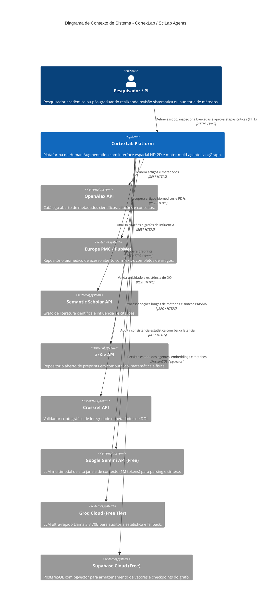
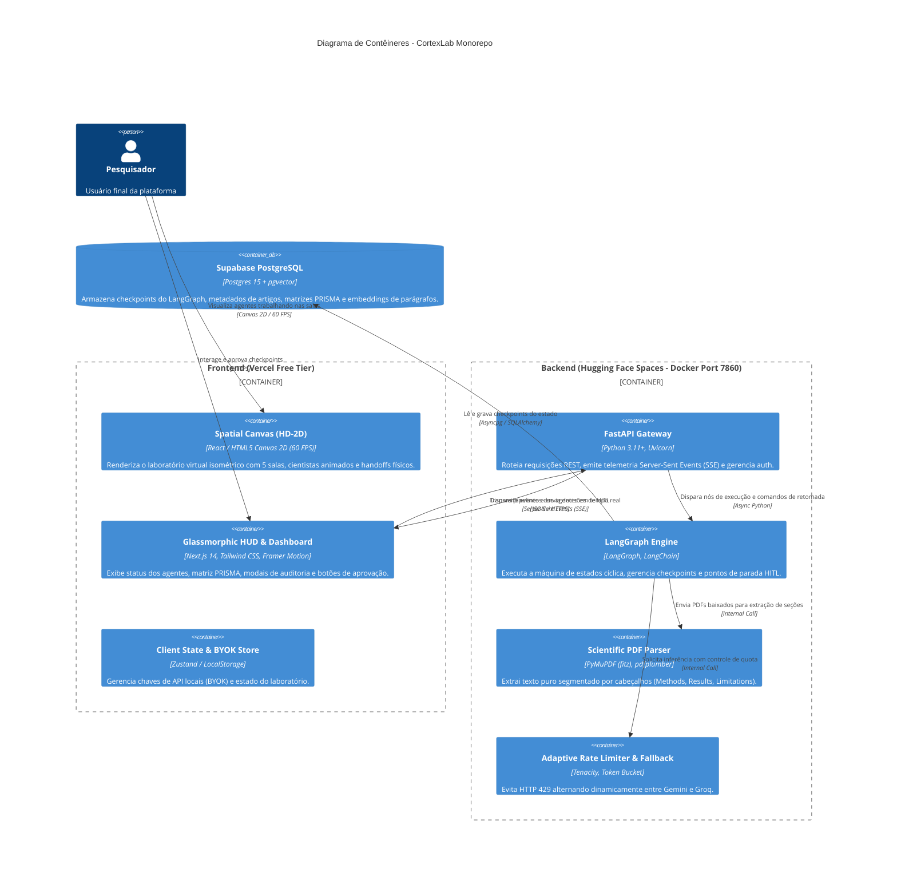
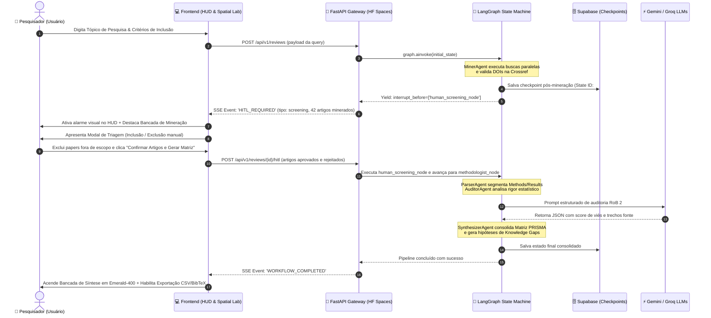

# 📐 Arquitetura de Software: CortexLab / SciLab Agents
## Diagramas C4 e Máquina de Estados LangGraph com Human-in-the-Loop (HITL)

> **Documento:** ARCH-001  
> **Versão:** 1.0.0  
> **Padrão:** C4 Model (Contexto, Contêineres, Componentes) + Mermaid.js State & Sequence Diagrams  
> **Premissa:** Arquitetura 100% Zero-Cost, desacoplada, reativa e auditável por humanos.

---

## 1. Nível 1: Diagrama de Contexto do Sistema (C4 System Context)

O diagrama abaixo ilustra como o pesquisador humano interage com o **CortexLab** e como o ecossistema se conecta aos serviços externos e APIs abertas gratuitas.



---

## 2. Nível 2: Diagrama de Contêineres (C4 Container Diagram)

Mostra a divisão de responsabilidades entre o frontend, backend, microsserviços e persistência, operando dentro das limitações de custo zero.



---

## 3. Nível 3: Diagrama de Componentes do Motor Multi-Agente (LangGraph)

Detalhamento dos nós especialistas que compõem o fluxo de trabalho cognitivo.

```mermaid
graph TD
    subgraph "LangGraph State Machine Architecture"
        Start([Início: Query do Pesquisador]) --> NodeMiner["1. MinerAgent<br/>(Busca federada OpenAlex, EuropePMC, arXiv)"]
        
        NodeMiner --> NodeCrossref["2. DOIValidator<br/>(Validação criptográfica Crossref)"]
        
        NodeCrossref --> CheckpointScreening{"🛑 HITL Checkpoint 1:<br/>Aprovação da Triagem Inicial"}
        
        CheckpointScreening -->|Pesquisador Rejeita/Ajusta| NodeMiner
        CheckpointScreening -->|Pesquisador Aprova| NodeDownloader["3. PDFDownloader<br/>(Download Open Access assíncrono)"]
        
        NodeDownloader --> NodeParser["4. SectionParserAgent<br/>(Segmentação: Methods, Results, Limitations)"]
        
        NodeParser --> NodeAuditor["5. AuditorAgent<br/>(Análise de Viés RoB 2, P-hacking, Poder N)"]
        
        NodeAuditor --> DecisionBias{"Risco de Viés Alto<br/>ou Inconclusivo?"}
        
        DecisionBias -->|Sim (Score < 0.70)| CheckpointBias{"🛑 HITL Checkpoint 2:<br/>Arbitragem Humana de Viés"}
        DecisionBias -->|Não (Confiável)| NodeSynthesizer["6. SynthesizerAgent<br/>(Matriz PRISMA e Knowledge Gaps)"]
        
        CheckpointBias -->|Pesquisador Valida ou Descarta| NodeSynthesizer
        
        NodeSynthesizer --> NodeExporter["7. ExportAgent<br/>(Gera CSV, BibTeX e PRISMA Flowchart)"]
        
        NodeExporter --> End([Fim: Matriz Pronta no HUD])
    end

    style CheckpointScreening fill:#f59e0b,stroke:#d97706,stroke-width:2px,color:#000
    style CheckpointBias fill:#f43f5e,stroke:#e11d48,stroke-width:2px,color:#fff
    style NodeMiner fill:#0284c7,stroke:#0369a1,stroke-width:2px,color:#fff
    style NodeAuditor fill:#7c3aed,stroke:#6d28d9,stroke-width:2px,color:#fff
    style NodeSynthesizer fill:#059669,stroke:#047857,stroke-width:2px,color:#fff
```

---

## 4. Diagrama de Sequência: Ciclo de Vida do Human-in-the-Loop (HITL)

O diagrama abaixo detalha a coreografia de parada e retomada de execução com persistência de estado.



---

## 5. Mapeamento dos Estados e Transições do Grafo (State Machine Specification)

| Estado Atual | Gatilho / Evento | Próximo Estado | Comportamento de Persistência |
| :--- | :--- | :--- | :--- |
| `IDLE` | Usuário submete query | `MINING` | Cria nova `thread_id` no Supabase |
| `MINING` | Busca concluída com sucesso | `VALIDATING_DOIS` | Atualiza lista bruta de papers |
| `VALIDATING_DOIS` | Todos os DOIs validados | `AWAITING_SCREENING_APPROVAL` | Grava checkpoint e **pausa** (`interrupt`) |
| `AWAITING_SCREENING_APPROVAL` | Usuário aprova triagem | `PARSING_PDFS` | Retoma execução com a lista de aprovados |
| `AWAITING_SCREENING_APPROVAL` | Usuário cancela | `CANCELLED` | Finaliza thread e libera memória |
| `PARSING_PDFS` | Seções segmentadas | `AUDITING_METHODS` | Armazena seções estruturadas |
| `AUDITING_METHODS` | Risco detectado $\ge$ Limiar | `AWAITING_BIAS_ARBITRATION` | Grava checkpoint e **pausa** (`interrupt`) |
| `AUDITING_METHODS` | Risco normal/baixo | `SYNTHESIZING_PRISMA` | Segue direto sem parada |
| `AWAITING_BIAS_ARBITRATION` | Usuário arbitra viés | `SYNTHESIZING_PRISMA` | Injeta nota humana no relatório de viés |
| `SYNTHESIZING_PRISMA` | Matriz e Gaps gerados | `EXPORT_READY` | Gera links de download para CSV e BibTeX |
| `EXPORT_READY` | Usuário fecha revisão | `COMPLETED` | Arquiva resultado |
